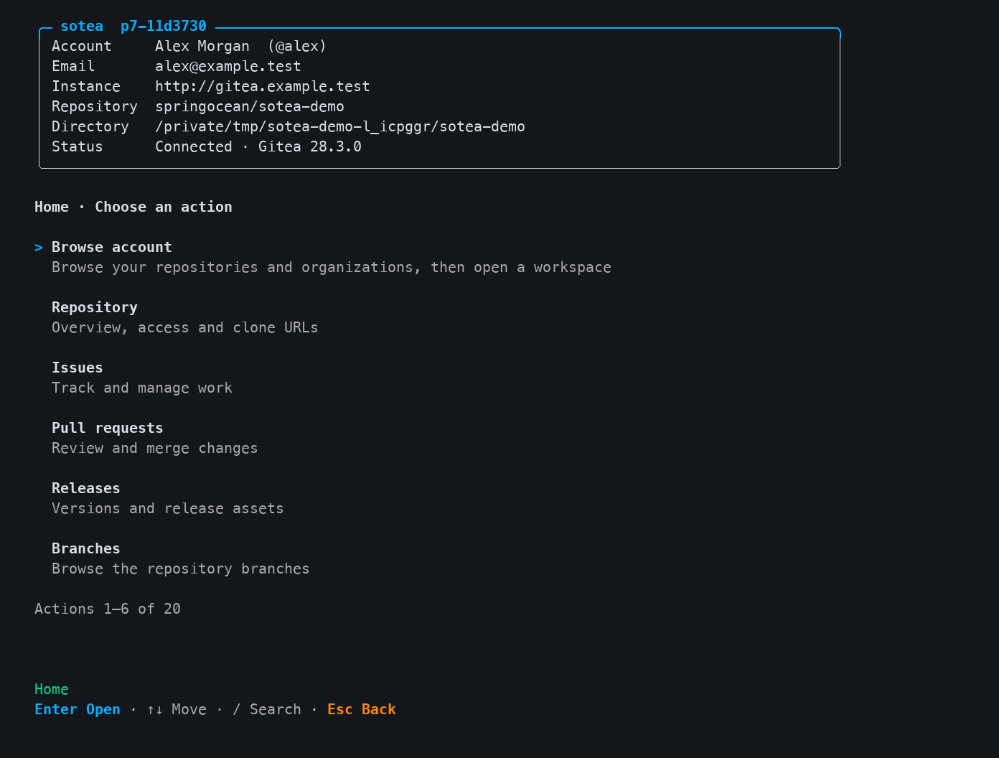
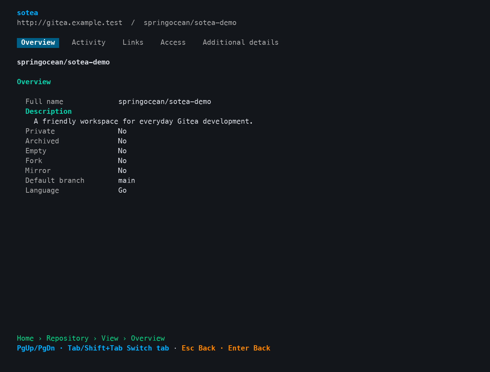
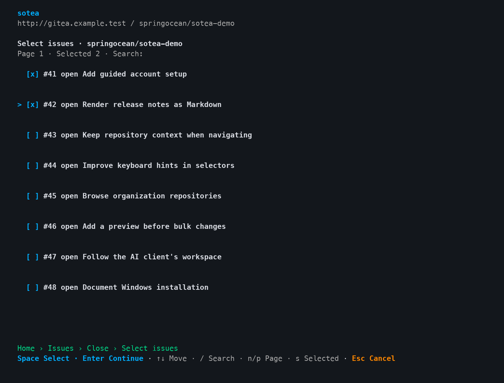
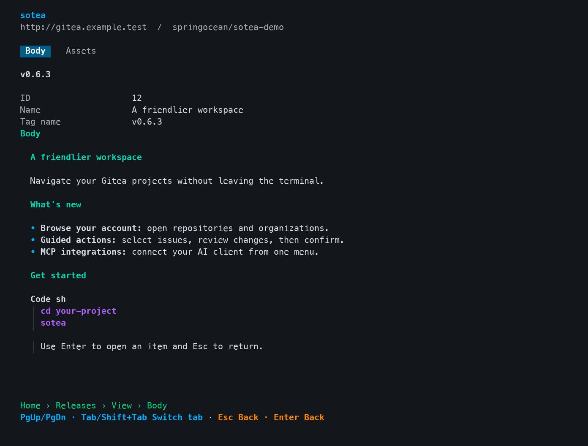
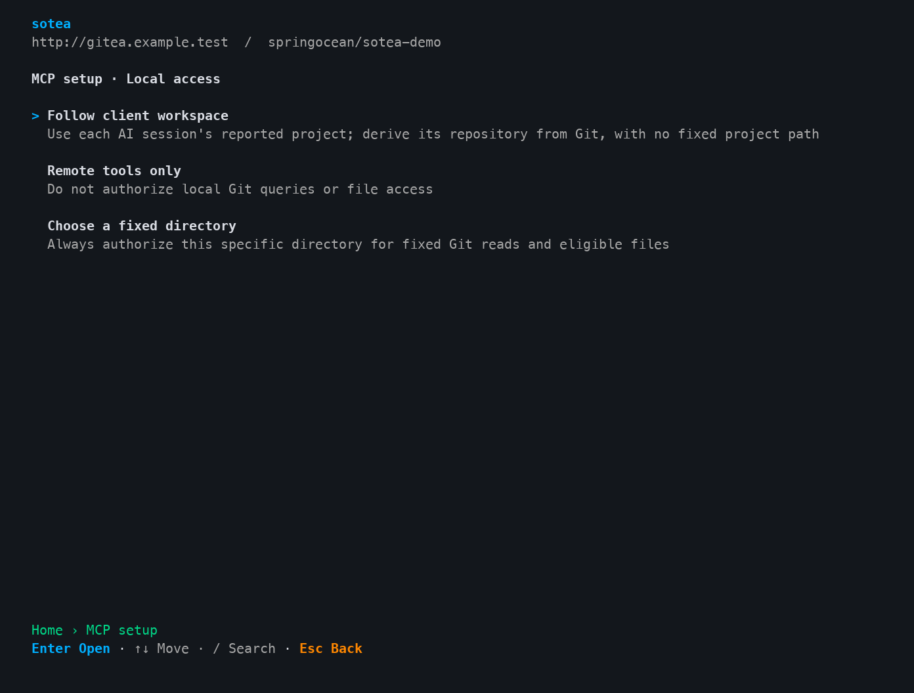

# sotea

[](cmd/sotea/VERSION)
[](docs/compatibility.md#发布状态与问题反馈)
[](https://github.com/Spring-Ocean/gitea-cli-so/actions/workflows/ci.yml)
[](https://github.com/Spring-Ocean/gitea-cli-so/actions/workflows/release.yml)
[](go.mod)
[](LICENSE)
[](docs/usage.md)
[](docs/mcp.md)

[](docs/compatibility.md#平台)
[](docs/compatibility.md#平台)
[](docs/configuration.md#git-凭证的匹配范围)
[](docs/compatibility.md#gitea)
[](docs/README.md)

面向自部署 Gitea 的命令行工具。用同一个 Go 可执行程序，通过命令行、交互菜单或本地 MCP 服务处理仓库、Issue、Pull Request 和 Release。

A CLI for self-hosted Gitea. Manage repositories, issues, pull requests, and releases through commands, interactive menus, or a local MCP server, all from a single Go executable.

## 能做什么 / Features

| 能力 / Feature | 使用方式 / How it works |
| --- | --- |
| 交互工作台 / Interactive workspace | 在项目目录运行 `sotea`，自动识别仓库；浏览账户、组织和仓库，查看详情并逐步执行操作。<br>Run `sotea` in a project directory to detect the repository, browse accounts, organizations, and repositories, view details, and follow guided operations. |
| 开发流程 / Development workflows | 创建和管理 Issue、讨论与审查 PR、合并代码、准备和发布 Release、上传附件。<br>Create and manage issues, discuss and review pull requests, merge changes, prepare and publish releases, and upload assets. |
| Git 与 API / Git and API | 调用系统 Git，复用经过身份验证的 HTTPS Git 凭证；通过 `sotea api` 调用当前账号有权访问的 Gitea API。<br>Use system Git and verified HTTPS Git credentials. Call Gitea APIs available to the selected account through `sotea api`. |
| AI 客户端接入 / AI client integrations | 内置 stdio MCP，提供 Codex、Claude Code、Cursor、VS Code 配置向导；支持跟随客户端项目。<br>Built-in stdio MCP with setup wizards for Codex, Claude Code, Cursor, and VS Code, including support for following the client's project. |
| 自动化 / Automation | 业务命令支持 JSON、明确的退出码和非交互运行；写操作默认预览确认。<br>Business commands provide JSON output, defined exit codes, and non-interactive execution. Writes require a preview and confirmation by default. |
| 更新 / Updates | Home 每五小时最多后台检查一次 GitHub Releases，新版高亮提示；确认后自动下载、校验和安装，保留旧程序备份。<br>Home checks GitHub Releases in the background at most once every five hours, highlights new versions, and offers confirmed download, verification, and installation with a backup. |

程序界面与提示使用英文；本 README 中英对照，详细文档目前使用中文。仓库中的标题、正文和评论保留原文。

The interface and prompts are in English. This README is bilingual; detailed documentation is currently in Chinese. Repository titles, body text, and comments retain their original language.

## 交互工作台 / Interactive workspace

从首页查看账号、实例和仓库，使用键盘进入操作，结果直接留在工作台中。

See your account, instance, and repository at a glance. Navigate with the keyboard and view results inside the workspace.

[](docs/assets/screenshots/workspace-home.png)

以下展示图来自实际 sotea 程序的隔离示例会话，终端输出渲染为 PNG；账号、仓库和业务内容均为演示数据。终端主题可能影响颜色。展开可查看更多场景，点击图片查看原尺寸。

These images show terminal output captured from the actual sotea executable in an isolated demo session and rendered as PNGs. Accounts, repositories, and content are sample data. Colors may vary with your terminal theme. Expand a scene below, or click an image for full size.

<details>
<summary><strong>仓库详情 / Repository details</strong> — 分组标签与清晰的字段层级 / Tabs and readable fields</summary>

仓库信息按概览、活跃度、链接和访问权限分组，通过 Tab 或 PageUp／PageDown 切换。

Repository details are grouped into overview, activity, links, and access. Switch tabs with Tab or PageUp/PageDown.

[](docs/assets/screenshots/repository-overview.png)

</details>

<details>
<summary><strong>Issue 多选 / Issue selection</strong> — 勾选目标，再继续操作 / Select targets before continuing</summary>

使用 Space 勾选多个 Issue，Enter 继续到变更预览与确认；支持搜索、分页和检查已选项。

Select multiple issues with Space, then press Enter to preview and confirm the changes. Search, pagination, and a selected-items view help manage the selection.

[](docs/assets/screenshots/issue-selection.png)

</details>

<details>
<summary><strong>Release 正文 / Release notes</strong> — 直接阅读 Markdown / Read rendered Markdown</summary>

标题、列表、强调、代码块和引用直接在终端中呈现，底部显示当前页面路径与返回操作。

Read headings, lists, emphasis, code blocks, and quotes directly in the terminal, with a page breadcrumb and navigation hints below.

[](docs/assets/screenshots/release-markdown.png)

</details>

<details>
<summary><strong>MCP 接入向导 / MCP integration wizard</strong> — 选择项目访问方式 / Choose workspace access</summary>

逐步选择客户端、实例、账号、本地访问方式和权限；可跟随 AI 客户端当前项目，也可仅使用远端工具或绑定固定目录。

Choose a client, instance, account, local access mode, and permissions step by step. Follow the AI client's current project, use remote tools only, or select a fixed directory.

[](docs/assets/screenshots/mcp-workspace.png)

</details>

## 快速开始 / Quick start

安装对应平台的预编译程序，放入 PATH；运行时无需 Go。安装、升级和卸载步骤见 [安装说明](docs/installation.md)。

Install the prebuilt executable for your platform and add it to PATH. Go is not required at runtime. See the [installation guide](docs/installation.md) for installation, upgrades, and removal.

从对应 GitHub Release 获取安装脚本，可首次安装当前 RC；自动选择平台、校验 SHA-256，并配置用户 PATH。已有程序不会被覆盖。默认不传版本参数时安装最新稳定版，RC 必须指定版本。

Use the commands below to install this RC from its GitHub Release assets. Installers select the platform, verify SHA-256, and configure your user PATH. Existing installations are never overwritten. Without a version argument, installers select the latest stable release; an RC requires an explicit version.

**macOS · Terminal / iTerm2**

```sh
(
    set -e
    installer=$(mktemp)
    trap 'rm -f "$installer"' EXIT
    curl --proto '=https' --proto-redir '=https' --tlsv1.2 -fsSL \
        https://github.com/Spring-Ocean/gitea-cli-so/releases/download/v0.1.0-rc.5/install.sh \
        -o "$installer"
    sh "$installer" --version v0.1.0-rc.5
)
```

**Windows · PowerShell 5.1 / PowerShell**

```powershell
& ([scriptblock]::Create([Text.Encoding]::UTF8.GetString((Invoke-WebRequest -UseBasicParsing -ErrorAction Stop -Uri 'https://github.com/Spring-Ocean/gitea-cli-so/releases/download/v0.1.0-rc.5/install.ps1').RawContentStream.ToArray()).TrimStart([char]0xFEFF))) -Version v0.1.0-rc.5
```

也可以手动下载对应平台压缩包和 SHA256SUMS，校验后安装。发布维护流程见 [Release 说明](docs/releases.md)。安装完成后，重新打开终端并执行：

You can also download the platform archive and SHA256SUMS for manual verification and installation. Maintainers can follow the [release guide](docs/releases.md). After installation, open a new terminal and run:

```sh
sotea version
cd /path/to/project
sotea
```

首次使用，在 **Account** 中按提示绑定 Gitea 实例和账号。已经配置 HTTPS Git 凭证的仓库也可以执行：

On first use, open **Account** and follow the prompts to connect your Gitea instance and account. If the repository already has HTTPS Git credentials configured, you can also run:

```sh
sotea auth login --credential-source git
sotea auth status --check
sotea repo view
sotea issue list --state open
```

没有本地仓库时，先通过菜单连接实例，再使用 **Browse account**；也可显式指定目标：

Without a local repository, connect an instance through the menu and use **Browse account**, or specify the target explicitly:

```sh
sotea --instance team --repo owner/repository issue list
```

`team` 是保存的实例名。token、私有 CA、多账号和 SSH remote 的处理见 [配置与认证](docs/configuration.md)。

`team` is the saved instance name. See [configuration and authentication](docs/configuration.md) for tokens, private CAs, multiple accounts, and SSH remotes.

## 常用操作 / Common operations

```sh
sotea issue view 42
sotea issue close
sotea pr list
sotea pr review create 42 --event approve
sotea release create v1.0.0 --target main --notes-file release-notes.md
sotea --workdir /path/to/project git -- status
```

在可交互终端中，`issue close` 不带编号会先列出候选供选择；直接传编号也会预览确认。Release 默认创建为草稿。菜单内 Enter 进入、Esc 返回，批量资源使用 Space 勾选。

In an interactive terminal, `issue close` without numbers opens a selector. Explicit numbers still require a preview and confirmation. Releases are created as drafts by default. In menus, Enter opens an item, Esc goes back, and Space selects items for batch operations.

完整操作示例、分页、JSON、脚本与退出码见 [使用指南](docs/usage.md)。

See the [usage guide](docs/usage.md) for more examples, pagination, JSON output, scripting, and exit codes.

## 更新 / Updates

Home 会在后台检查 GitHub Releases，每个系统用户五小时内最多自动检查一次，失败也计入冷却。发现新版时高亮提示，进入 **Update** 确认后自动下载、校验、安装并保留旧程序备份。

Home checks GitHub Releases in the background at most once every five hours per system user, including failed attempts. New versions are highlighted. Open **Update** to confirm download, verification, and installation with a backup.

```sh
sotea update check
sotea update install
```

稳定版默认只跟进稳定版，RC 默认包含预发布；可显式使用 `--prerelease`。脚本安装需 `--yes`，安装后重启 sotea 和已运行的 MCP 进程。设置 `SOTEA_UPDATE_CHECK=never` 可关闭自动检查。详情见 [更新说明](docs/updates.md)。

Stable builds follow stable releases; RC builds also include prereleases. Use `--prerelease` to opt in explicitly. Scripted installation requires `--yes`. Restart sotea and running MCP processes afterwards. Set `SOTEA_UPDATE_CHECK=never` to disable automatic checks. See the [update guide](docs/updates.md).

源码新增 GitHub 凭证自动复用：环境 token → gh → Git helper → 匿名；仅固定 API 携带认证。`SOTEA_GITHUB_AUTH=anonymous` 可关闭查询；更新命令支持 `--github-auth anonymous`。此功能从 rc.5 开始提供，旧版附件保持原样。

The source now reuses GitHub credentials in this order: environment tokens → gh → Git credential helper → anonymous. Only the fixed API receives authentication. Set `SOTEA_GITHUB_AUTH=anonymous` to disable credential lookup, or use `--github-auth anonymous` on update commands. Available starting with rc.5; earlier release assets remain unchanged.

## 连接 AI 客户端 / Connect AI clients

运行 `sotea`，进入 **MCP integrations**，选择客户端与用户／项目范围，再选择实例、账号、本地访问模式和权限。预览配置后确认安装，客户端会自动管理 MCP 子进程。

Run `sotea`, open **MCP integrations**, and select the client and user or project scope. Then choose the instance, account, local access mode, and permissions. Review and confirm the configuration; the client will manage the MCP subprocess automatically.

- **Follow client workspace**：同一接入配置跟随不同项目，不固定当前目录。<br>Reuse one integration across projects without pinning the current directory.
- **Choose a fixed directory**：只授权指定目录内的本地能力。<br>Authorize local capabilities only within the selected directory.
- **Remote tools only**：只使用远端工具。<br>Use remote tools only.

默认只读，业务写入和原始 API 独立开启。接入、更新、移除及故障处理见 [MCP 接入指南](docs/mcp.md)。

Access is read-only by default. Business writes and raw API access are enabled separately. See the [MCP integration guide](docs/mcp.md) for setup, updates, removal, and troubleshooting.

模型调用使用 sotea 参数契约；Release 的 `tag`／`target` 等字段区别和完整示例见 [MCP 模型调用指南](docs/mcp-agent-guide.md)。

Model calls follow the sotea parameter contract. See the [MCP agent guide](docs/mcp-agent-guide.md) for Release `tag`/`target` fields and complete examples.

## 平台与当前状态 / Platforms and current status

当前版本为 **v0.1.0-rc.5**，是增加 GitHub 凭证复用、匿名模式及限流诊断的小型修复预发布版。

The current version is **v0.1.0-rc.5**, a small bug-fix prerelease adding GitHub credential reuse, anonymous mode, and rate-limit diagnostics.

目标平台为 macOS 15 起的 arm64／amd64，以及 Windows 10 22H2／Windows 11 的 amd64。Git 集成功能基线为 Git 2.43。

Target platforms are macOS 15 and later on arm64 and amd64, plus Windows 10 22H2 and Windows 11 on amd64. The Git integration baseline is Git 2.43.

**Gitea 支持版本 / Supported Gitea versions:** `28.3.0` · `1.27.3` · `1.26.4` · `1.25.5` · `1.24.7` · `1.23.8` · `1.22.6`。

项目目前处于发布前验收阶段。七个指定 Gitea 版本的共同业务及 MCP 回归已通过；Windows、macOS 最低版本／Intel、目标终端和四客户端完整 UI 仍有待实测项。预编译包通过 GitHub Releases 分发；当前未提供 Developer ID／公证或 Authenticode 签名。具体版本和验证边界见 [兼容性说明](docs/compatibility.md)，Windows 实测入口见 [Windows 验证指南](docs/windows-validation.md)。

The project is undergoing pre-release acceptance testing. Shared business workflows and MCP regression checks have passed against seven specified Gitea versions. Testing remains pending for Windows, the minimum macOS version and Intel Macs, target terminals, and the complete UI flows of all four clients. Prebuilt packages are distributed through GitHub Releases; Developer ID signing, notarization, and Authenticode signing are not provided. See [compatibility and validation status](docs/compatibility.md) for exact versions and coverage, and the [Windows validation guide](docs/windows-validation.md) for Windows testing.

## 从源码构建 / Build from source

使用 **Go 1.27.3**，保持现有模块路径。以下命令可在仓库根目录执行：

Use **Go 1.27.3** and keep the existing module path. Run the following commands from the repository root:

```sh
go version
go test ./...
go vet ./...
go build -o bin/sotea ./cmd/sotea
./bin/sotea version
```

Windows PowerShell 下使用以下命令：

For Windows PowerShell, use:

```powershell
go build -o bin/sotea.exe ./cmd/sotea
.\bin\sotea.exe version
```

普通源码构建从 [VERSION](cmd/sotea/VERSION) 读取版本，当前显示 `v0.1.0-rc.5`；CI 构建附加 `+ci.<commit>` 标识。开发文档、设计与验收记录保存在本地 `devdocs/`，该目录已加入 Git 忽略规则；对外使用文档统一放在 [docs/](docs/README.md)。隔离测试环境的执行说明保留在 [tests/integration](tests/integration/README.md)。

Source builds read their version from [VERSION](cmd/sotea/VERSION), currently `v0.1.0-rc.5`. CI builds append `+ci.<commit>` for traceability. Development documentation, designs, and acceptance records are kept locally in `devdocs/`, which is ignored by Git. User documentation lives in [docs/](docs/README.md). Instructions for the isolated test environment are in [tests/integration](tests/integration/README.md).

GitHub Actions 在 push 和 PR 时执行格式、依赖、静态分析、竞态回归及 macOS／Windows 原生测试和构建，并在 macOS 验证菜单与 MCP 冒烟。纯公开文档变更跳过 Go 检查。运行范围和本地复现见 [CI 说明](docs/ci.md)。

GitHub Actions checks formatting, dependencies, static analysis, races, and native macOS/Windows tests and builds on pushes and pull requests. macOS also runs menu and MCP smoke checks. Public documentation-only changes skip Go checks. See the [CI guide](docs/ci.md) for scope and local commands.

## 许可证 / License

本项目采用 [MIT License](LICENSE)。

This project is licensed under the [MIT License](LICENSE).

Copyright (c) 2026 springocean.
